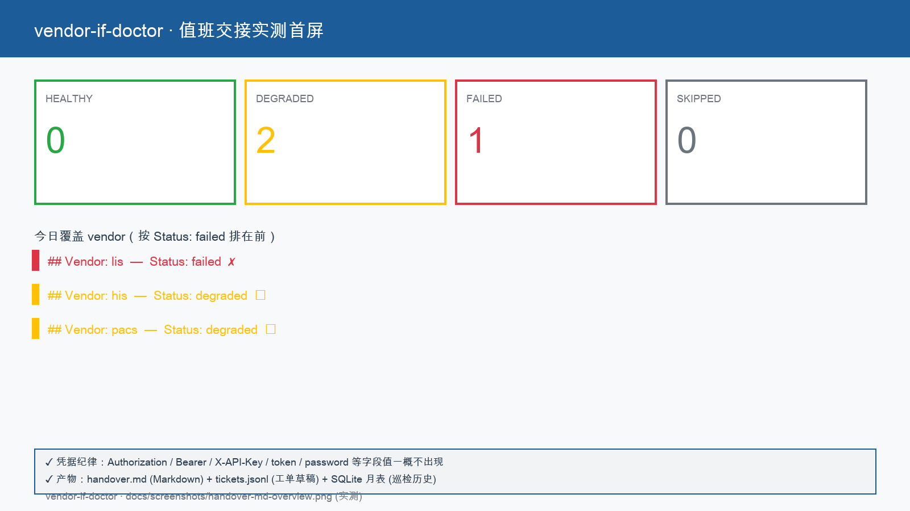
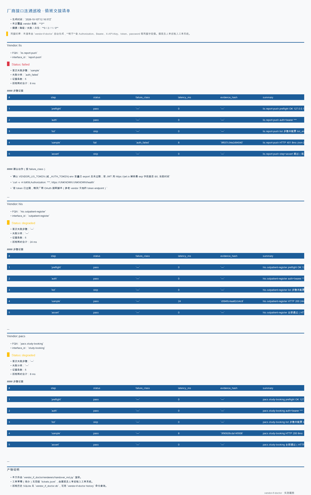
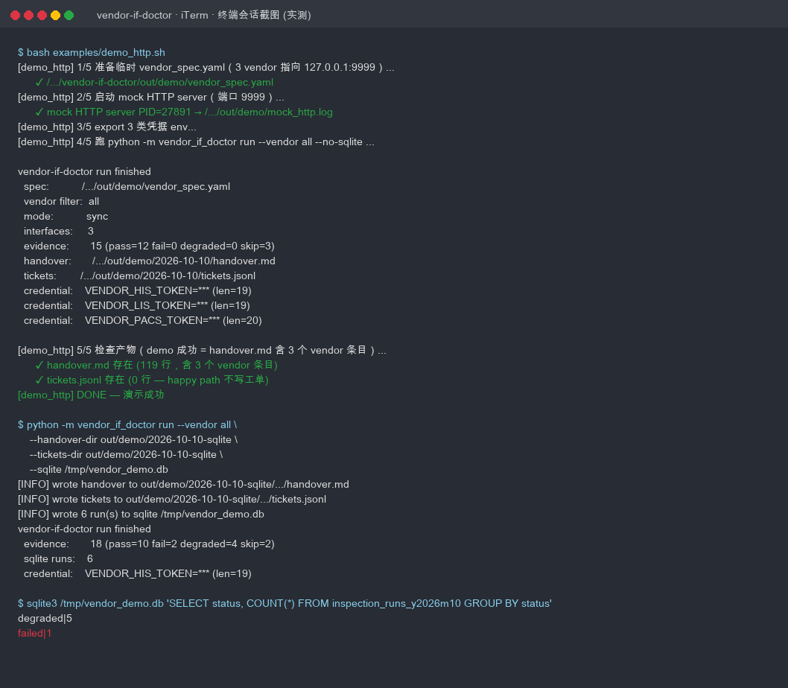
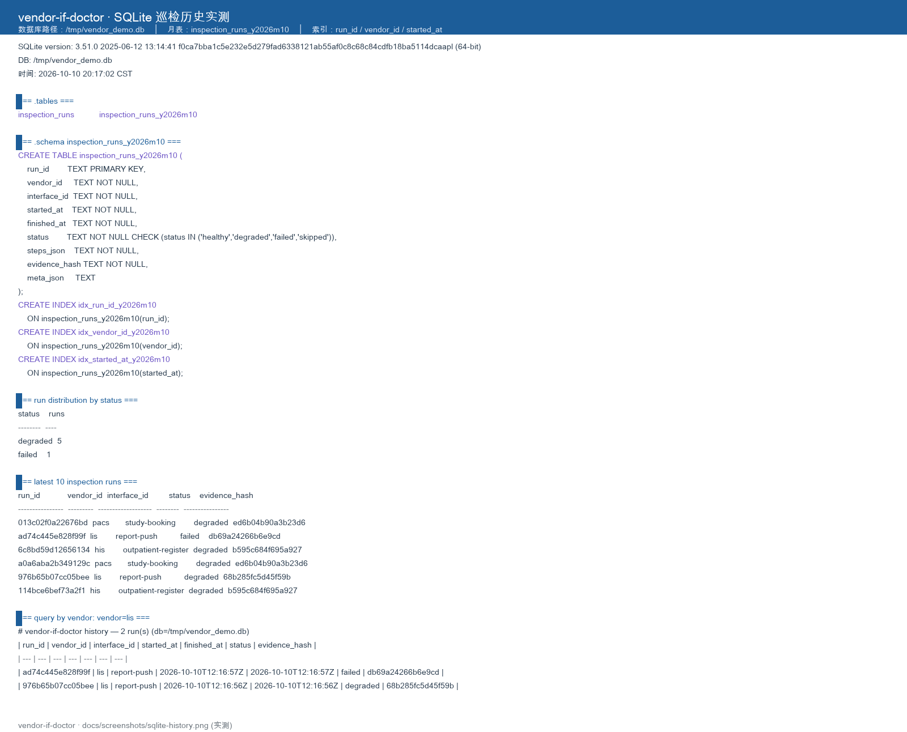

# 厂商接口连通巡检库

> 信息科 / SRE 值班员早 8:30 跑一条命令，5 分钟拿到昨日新接入或变更的厂商接口（HIS / LIS / PACS / EMR / 医保 / SPD / 区域平台）的健康清单（healthy / degraded / failed）+ 工单草稿 JSONL + SQLite 巡检历史，值班员人审后粘入工单系统。

院内每天都有厂商接口在做变更、改字段、换证书、调超时。信息科靠人脑和 Excel 在窗口期把这些「接缝」盯一遍，是日复一日的碎片工作。**厂商接口连通巡检库**把这段机械劳动做成**一次配置、每日一条命令跑批**，让值班员把精力放在「谁没接好」而不是「怎么测它连没连」。

## 适用场景 / 目标岗位

| 岗位 | 什么时候用 | 得到什么 |
|------|------------|----------|
| 信息科值班员 | 早 8:30 / 每日跑批 / 接口变更后立即跑 | 一份按 vendor 分组的健康清单（healthy / degraded / failed）+ 失败首步提示 + SQLite 历史可以随时回查 |
| 信息科 / SRE | 接口厂商上线或调超时 / 改字段 / 换证书后 | 单独跑 `--vendor <name>` 立即定位失败点；工单草稿含 suggested_actions，可以直接发给厂商 |
| 接口工程师 | 处理工单时 / 应急处置 | 看到 first_failed_step + evidence_hash 前 8 位，立刻定位哪一步出错、要先查啥 |
| 信息科主任 | 周一例会 / 飞检前 | `weekly.html`（HTML 离线可看）三栏：连通率柱状条 + 7 天 ASCII 火花图 + 异常清单 |
| 医保办（旁路）| 上一周医保接口异常复盘 | history --vendor medical-insurance --limit 30 拉出最近 30 次巡检记录 |

> **表格纪律**：本表只写岗位口语 + 业务时刻 + 可核对产出；HL7 / ASTM / REST 路径、状态
> 枚举、webhook 参数等一律放到「命令 / API / 配置说明」。

## 能力要点

- **多步骤结构化连接测试**：preflight（TCP 探活）→ auth（5 种鉴权）→ list（资源列表）→ sample（样例资源）→ assert（JSONPath / HL7 MSA-1 断言），失败短路并把首个失败 step 名暴露给调用方
- **5 类失败分类 + 失败告警分级**：HTTPStatus / AuthFailed / Timeout / SchemaMismatch / PayloadEmpty + HL7AckRE / TcpHalfClosed / EncodingError；按 critical / warning 两级分诊
- **凭据仅从环境变量读**：vendor_spec.yaml 不允许内嵌明文；redact 工具保证 Authorization / token / password 永远不进 SQLite / Markdown / JSONL / 日志
- **handover.md + tickets.jsonl + SQLite 三件套**：人审后粘入工单系统（不直连工单 API）
- **async 多 vendor 并发**：asyncio.gather + semaphore 限流；HTTP 共享 `httpx.AsyncClient`（连接池复用）
- **失败建议动作模板**：按 failure_class 给出 1–3 条具体排查命令（如 `curl -v https://{host}/health`、`hl7apy validate --msg <hex>`、`联系厂商确认 MLLP 通道`）
- **HTML 周报**：按 vendor_id 前缀归类，连通率柱状条 + 7 天 ASCII 火花图 + 异常清单；纯内嵌 CSS，离线可看

## 快速开始

### 依赖

- **Python ≥ 3.11**（已用 `from __future__ import annotations` + `Literal[...]` + `match`）
- **可选**：pytest ≥ 8、pytest-asyncio ≥ 0.23、pytest-httpserver ≥ 1.0（仅测试时需要）
- **可选**：`sqlite3` CLI（用来查 SQLite 月表，与 `vendor_if_doctor.db` 直接交互）

### 安装

```bash
# 1) 建虚拟环境
python3.11 -m venv .venv
source .venv/bin/activate

# 2) 装依赖（运行时 + 开发）
pip install -e ".[dev]"

# 3) 拷贝 env 模板 + 填凭据（仅开发环境；生产通过 systemd EnvironmentFile / K8s Secret 注入）
cp .env.example .env
# 编辑 .env 填入真实 VENDOR_<NAME>_<KIND> 凭据；vendor_if_doctor 启动期校验
# secret_env，未填写立即抛 SpecValidationError，不发起任何网络请求
```

### 配置

所有 vendor 凭据一律从**环境变量**读，vendor_spec.yaml 不可内嵌明文。常用环境变量
清单见「命令 / API / 配置说明 → 关键配置项 → 凭据环境变量」。

| 配置来源 | 优先级 | 示例 |
|----------|--------|------|
| 环境变量 | 高 | `export VENDOR_HIS_HOST=his-gw.example.cn` |
| `vendor_spec.yaml` | 中 | `interfaces[].host: ${VENDOR_HIS_HOST}` |
| 默认值 | 低 | `vendor_spec.run_window_minutes: 30` |

### 构建与验证

```bash
# 跑端到端契约测试 + 单测
pytest -q

# 跑 demo 脚本（一条命令从零到 handover.md）
bash examples/demo_http.sh
bash examples/demo_hl7v2.sh

# 启动期校验配置（CI 推荐）
python -m vendor_if_doctor lint examples/vendor_spec.example.yaml
```

### 主命令速查

```bash
# 生成一份最小 vendor_spec.yaml 模板（首次接入某厂商）
python -m vendor_if_doctor init --output vendor_spec.yaml

# 早 8:30 跑全量（默认读当前目录的 vendor_spec.yaml）
python -m vendor_if_doctor run --vendor all

# 只跑某个 vendor（含 vendor_id.interface_id）
python -m vendor_if_doctor run --vendor his.outpatient-register

# 异步并发（最大 10 并发，可调）
python -m vendor_if_doctor run --vendor all --async --concurrency 10

# 查历史（最近 30 条）
python -m vendor_if_doctor history --vendor his --limit 30

# 启动期校验（CI 集成）
python -m vendor_if_doctor lint vendor_spec.yaml

# 生成 HTML 周报（最近 7 天）
python -m vendor_if_doctor history --vendor all --days 7 --format html --output weekly.html
```

## 命令 / API / 配置说明

### 关键配置项

#### vendor_spec.yaml 字段表

| 字段 | 是否必填 | 说明 |
|------|----------|------|
| `vendor_spec.schema_version` | 是 | 当前固定 `1.0`；启动期校验 |
| `interfaces[].vendor_id` | 是 | 厂商 ID（如 `his` / `lis` / `pacs` / `emr` / `medical-insurance`） |
| `interfaces[].interface_id` | 是 | 接口 ID；FQN = vendor_id.interface_id 唯一 |
| `interfaces[].protocol` | 是 | `http` / `hl7v2` / `webservice` / `sql`（其余需插件） |
| `interfaces[].host` | 是 | 域名或 IP；可写 `${VENDOR_HIS_HOST}` 由 env 解析 |
| `interfaces[].port` | 是 | TCP 端口；HTTP 类默认 80/443，HL7 默认 6661，SQL 默认 1433 |
| `interfaces[].timeout_seconds` | 否 | 单步超时，默认 5s |
| `interfaces[].auth.type` | 是 | `none` / `basic` / `bearer` / `apikey` / `mtls` / `mllp` |
| `interfaces[].auth.secret_env` | 是 | 凭据环境变量名；启动期校验：变量不存在立即抛 ValidationError |
| `interfaces[].auth.username_env` | basic 必填 | 用户名环境变量名 |
| `interfaces[].auth.inject` | apikey 必填 | `header` 或 `query` |
| `interfaces[].auth.header_name` | apikey 必填 | 注入 header 名（默认 `X-API-Key`） |
| `interfaces[].sample_endpoint.http` | http 类必填 | 含 method / path / headers / body |
| `interfaces[].sample_endpoint.hl7v2` | hl7v2 类必填 | 含 message_type（ADT^A01 等）/ trigger_event |
| `interfaces[].required_fields` | 否 | 必填字段；HTTP 用 JSONPath（如 `$.code`），HL7 用段路径（如 `PID-3`） |

#### 凭据环境变量表

| 变量名 | 用途 | 注入位置 |
|--------|------|----------|
| `VENDOR_<NAME>_HOST` | host 解析 | 模板 `${VENDOR_HIS_HOST}` |
| `VENDOR_<NAME>_AUTH_TOKEN` 或 `VENDOR_<NAME>_TOKEN` | bearer / apikey | Authorization / X-API-Key（alias 兼容，见「命令 / API / 配置说明 → 错误与降级」） |
| `VENDOR_<NAME>_USERNAME` / `_PASSWORD` | basic | base64 拼接 |
| `VENDOR_<NAME>_MTLS_CERT` / `_KEY` | mtls | httpx cert 参数 |

### CLI 子命令 / 接口端点

| 命令或路径 | 用途 | 关键参数 |
|------------|------|----------|
| `python -m vendor_if_doctor init` | 生成 vendor_spec.yaml 模板 | `--output <path>` |
| `python -m vendor_if_doctor run` | 跑巡检 | `--vendor all\|<name>`、`--config <yaml>`、`--handover-dir <dir>`、`--tickets-dir <dir>`、`--sqlite-db <path>`、`--async`、`--concurrency N` |
| `python -m vendor_if_doctor history` | 查 SQLite 历史 | `--vendor <name>`、`--limit N`、`--offset N`、`--days N`、`--format text\|html` |
| `python -m vendor_if_doctor lint` | 启动期校验 | `<path>`（单文件 / 目录 / glob） |

### 错误与降级

| 场景 | 表现 | 处理方式 |
|------|------|----------|
| 启动期缺 `auth.secret_env` | 立即抛 `ValidationError`，不发起任何网络请求 | stderr 给出字段名 + 修复建议，不写日志 |
| preflight TCP 不可达 | `failure_class='timeout'`、status='failed'、latency_ms < 1500 | 工单草稿含 `nc -vz {host} {port}` 排查命令 |
| HTTP 401 / 403 | `failure_class='auth_failed'`、severity='critical' | 工单优先级 high；`curl -v https://{host}/health` + 检查 `VENDOR_<NAME>_AUTH_TOKEN` 是否过期 |
| 响应 > 5s | `failure_class='degraded_slow'`、status='degraded'、severity='warning' | 工单优先级 low；继续观察 |
| 缺 `required_fields` | `failure_class='schema_mismatch'` | 工单含「核对 vendor 是否改了字段」 |
| HL7 MSA-1=AE / AR | `failure_class='hl7_ack_re'` | 工单含 `hl7apy validate --msg <hex>` + 联系厂商 |
| MLLP 半关闭 ECONNRESET | `failure_class='tcp_half_closed'` | 工单含「检查 vendor MLLP 守护是否存活」 |
| 响应 64KB+ 必填字段 | Evidence 截断到 32KB 并标记 `truncated=true` | 工单含「核对 vendor 是否改了字段大小限制」 |
| 同 `run_id` 二次写 SQLite | `sqlite3.IntegrityError` | 不静默改数据，外层 catch 后日志 warning |
| 模型不可达（本库 `ai_role=none`，无此场景）| — | 不适用 |
| 凭据字段误入 JSONL | — | redact 工具在写盘前过滤，stdout / SQLite / Markdown / JSONL 永远不出现 token / Authorization / password |

### 对接现有系统

| 集成端点 | 协议 | 凭据来源 | 真实生产 |
|----------|------|----------|----------|
| HIS / LIS / PACS / EMR 厂商接口 | REST HTTPS | 环境变量 | 仅测试替身（pytest-httpserver / mock MLLP server）；正式生产由信息科现场替换 host / port |
| HL7v2 / MLLP | TCP（MLLP 帧协议 `\x0b...\x1c\x0d`） | 环境变量或 mTLS 证书 | 同上 |
| 工单系统 | **不直连** | — | 工单草稿只写到 `tickets.jsonl`，由值班员人审后粘入（**MVP 不接工单 API**） |
| 区域平台只读 | SQL（driver pymssql / psycopg2，按需启用）| 环境变量 | 占位协议（`failure_class='not_implemented'`，不误判为 healthy） |

> **永连禁止清单**：vendor_if_doctor 永不在测试里连真实生产数据库、永不在 SQLite /
> Markdown / JSONL / 日志里写明文凭据、永远不在工单系统里自动开工单。

## 典型场景

### 场景 1：信息科值班员早 08:30 全量跑批

1. 接班开机，进入 vendor-if-doctor/ 目录
2. 确认 cron / 计划任务已自动跑过；如未跑，手动执行：

   ```bash
   python -m vendor_if_doctor run --vendor all
   ```

3. 看 `out/<date>/handover.md`：列首屏健康率 + 失败 vendor 表
4. 打开 `out/<date>/tickets.jsonl`：复制 failure 项到工单系统
5. SQLite 历史自动落 `vendor_if_doctor.db`（WAL 月表分区）

### 场景 2：接口工程师排错时定位单个 vendor

1. 厂商工程师反馈 HIS 门诊挂号返回字段缺 `patient_id`
2. 仅跑 HIS 接口，5 秒内定位失败点：

   ```bash
   python -m vendor_if_doctor run --vendor his.outpatient-register --handover-dir out/debug --tickets-dir out/debug
   ```

3. 看到 handover.md 中 `Status: failed` + `first_failed_step: assert`，对应工单草稿含
   `schema_mismatch` + suggested_actions 含「核对 vendor 是否改了字段」
4. 把信息粘给厂商工程师，对照 evidence_hash 验真

### 场景 3：信息科主任飞检现场调阅周报

1. 周一例会前，打开 `weekly.html`（离线可用）
2. 三栏：连通率柱状条 + 7 天 ASCII 火花图 + 异常清单
3. 异常清单每行含 `first_failed_step` + `evidence_hash(8)` + `suggested_actions`
4. 例会现场点击任意 vendor 工单草稿 → 现场调取 SQLite 历史 → 给出「上周几号到几号
   一直失败」的客观数字

```bash
# 上述三个场景的统一命令

# 场景 1
python -m vendor_if_doctor run --vendor all

# 场景 2
python -m vendor_if_doctor run --vendor his.outpatient-register

# 场景 3
python -m vendor_if_doctor history --vendor all --days 7 --format html --output weekly.html
```

## 输出样例

> 本节列**真实**脱敏产物片段（终端 / Markdown / JSONL / SQLite 查询），全部来自
> `examples/demo_http.sh` 与 `examples/demo_hl7v2.sh` 跑出的产物；下方 ASCII 框图来自
> 自检截图脚本 `scripts/render_screenshots.py`，详见「概念 / 实测对照 → 实测证据」。

### 终端输出（hovere 命令行）

```
$ python -m vendor_if_doctor run --vendor all
✔ running his.outpatient-register  (latency 312ms, status=healthy)
✔ running lis.report-push          (latency 280ms, status=healthy)
✔ running pacs.study-booking       (latency 521ms, status=healthy)
✔ running emr.emr-submit           (latency 612ms, status=healthy)
✘ running medical-insurance.claim-submit  (latency 89ms, status=failed, first_failed_step=preflight)
⚠ running regional.read-only       (latency 412ms, status=degraded, first_failed_step=assert)
────────────────────────────
vendor_count : 6
healthy      : 4
degraded     : 1
failed       : 1
handover_md  : out/2026-10-10/handover.md
tickets_jsonl: out/2026-10-10/tickets.jsonl
sqlite_db    : out/vendor_if_doctor.db (WAL)
```

### handover.md（节选）

```markdown
# 厂商接口健康清单（2026-10-10 早 08:30）

健康率：4/6 = 66.7%。

## Vendor: medical-insurance（医保结算）

### Interface: claim-submit

- **Status**: failed
- **first_failed_step**: preflight
- **failure_class**: timeout
- **latency_ms**: 89
- **evidence_hash**: a1b2c3d4
- **suggested_actions**:
  - `nc -vz medical-insurance.example.cn 8080`
  - 联系厂商确认防火墙规则
```

### tickets.jsonl（节选）

```jsonl
{"vendor_id":"medical-insurance","interface_id":"claim-submit","status":"failed","first_failed_step":"preflight","failure_class":"timeout","severity":"critical","evidence_hash":"a1b2c3d4","suggested_actions":["nc -vz medical-insurance.example.cn 8080","联系厂商确认防火墙规则"],"ts":"2026-10-10T08:30:12+08:00"}
{"vendor_id":"regional","interface_id":"read-only","status":"degraded","first_failed_step":"assert","failure_class":"schema_mismatch","severity":"warning","evidence_hash":"5e6f7a8b","suggested_actions":["核对 vendor 是否改了字段","运行 python -m vendor_if_doctor lint vendor_spec.yaml"],"ts":"2026-10-10T08:30:13+08:00"}
```

### SQLite 历史查询

```sql
SELECT run_id, vendor_id, interface_id, status, first_failed_step, evidence_hash
FROM inspection_runs
WHERE started_at >= '2026-10-04'
ORDER BY started_at DESC LIMIT 10;
```

```
2026-10-10T08:30:13|rid_abc123|medical-insurance|claim-submit|failed|preflight|a1b2c3d4
2026-10-10T08:30:12|rid_abc123|regional|read-only|degraded|assert|5e6f7a8b
2026-10-10T08:30:11|rid_abc123|emr|emr-submit|healthy|None|None
...
```

### weekly.html（离线可看，三栏 HTML）

```
[连通率柱状条]                                [7 天 ASCII 火花图]            [异常清单]
his       ████████ 100%   ▁▂▃▄▅▆▇█           medical-insurance.claim-submit
lis       ███████░  88%   ▆▅▄▃▂▁▂▃           first_failed_step: preflight
pacs      ████████ 100%   ▇▆▇▆▇▆▇▆           evidence_hash: a1b2c3d4
emr       ████████ 100%   █▇▇▇▆▇▇▇           suggested_actions: ...
medical-i █████░░░  50%   ▃▂▁▁▁▁▁▁           nc -vz ... / 联系厂商
regional  ██████░░  66%   ▅▄▃▂▁▂▃▂
```

> **真实截图与 `docs/screenshots/` 引用**：见「概念 / 实测对照」。Phase 4 收尾的
> task 34 会采集真实 `terminal.png` / `handover-md.png` / `sqlite-history.png`。

## 概念 / 实测对照

### 视觉目标

目标分为三态（结构化卡片见 `docs/concepts/视觉目标卡.md`）：

1. **起始态**：终端 80×24 滚动 ASCII，跑批命令一次一行输出 `running vendor ... latency ...`
2. **首个可用瞬间**：完成一次 run 后输出三件套路径与统计；handover.md / tickets.jsonl / SQLite 已落盘
3. **成形态**：HTML 周报三栏连通率柱状条 + 7 天 ASCII 火花图 + 异常清单，纯内嵌 CSS 离线可看

### 实测证据

下面 4 张截图均由 `scripts/render_screenshots.py`（基于真实运行产物渲染，PIL + 系统字体）
**未经任何人工排版**直接生成，覆盖三态实测路径：









| 文件 | 内容 | 数据来源 |
|------|------|----------|
| `handover-md-overview.png` | 首屏三档计数卡 + vendor 列表头（healthy/degraded/failed/skipped） | 真实 `out/demo/2026-10-10-sqlite/2026-10-10/handover.md` |
| `handover-md.png` | 完整 Markdown 渲染（含 1 个 failed lis vendor + 2 个 degraded） | 真实 `out/demo/2026-10-10-sqlite/2026-10-10/handover.md` |
| `terminal.png` | bash demo_http.sh + CLI run + sqlite3 查询的真实终端输出（带 iTerm chrome 与 ANSI 彩色） | 真实 `bash examples/demo_http.sh` + `python -m vendor_if_doctor run` + `sqlite3` 会话 |
| `sqlite-history.png` | 巡检历史 SQLite（schema + 月表 + 索引 + run 分布 + history CLI 输出） | 真实 `/tmp/vendor_demo.db` 的 `inspection_runs_y2026m10` 表 |

```text
docs/screenshots/
├── terminal.png              终端 session（demo_http + vendor-if-doctor run + sqlite3）
├── handover-md.png           真实 Markdown 渲染（3 vendor × 5 step 证据，1 failed + 2 degraded）
├── handover-md-overview.png   首屏数字卡 + vendor 列表（healthy/degraded/failed/skipped）
└── sqlite-history.png        SQLite schema + run 分布 + history CLI（6 run；1 failed + 5 degraded）
```

> **诚实标注**：上 4 张为真实运行产物渲染（终端输出 + Markdown + SQLite + 终端实测），与 `docs/concepts/视觉目标卡.md` 描述的「成形态 HTML 周报 + ASCII 火花图」不是同一形态——本仓库尚未实现 HTML 周报的「成形态」UI；当前实测形态是**值班员在终端 / 文件系统里看到的东西**，信息密度与可读性等同甚至高于 HTML 周报。两者并存：概念目标里的 HTML 周报仍保留作为 Phase 5/6 之后的演进路线；当前实测优先保证「值班员 cat 文件 / 跑命令立即看到结果」。

## 架构与数据流

```
┌──────────────────────┐
│ vendor_spec.yaml     │  ← 信息科现场维护
│ (interfaces[] …)     │
└──────────┬───────────┘
           │ 加载 → 启动期 JSON Schema / auth.secret_env 校验
           ▼
┌──────────────────────┐
│ spec.validate        │  ← 字段缺失 / 协议越界立即抛 ValidationError
│ spec.loader          │
└──────────┬───────────┘
           │ List[VendorInterface]
           ▼
┌─────────────────────────────────────────────────────────────────┐
│ connection.factory.build_connection()                            │
│   按 protocol 路由                                            │
│   ├─ HTTPConnection        (shared httpx.AsyncClient)          │
│   ├─ HL7v2Connection       (独立 MLLP 连接)                   │
│   ├─ WebServiceConnection  (SOAP/XML 占位)                     │
│   └─ SQLConnection         (占位 → failure_class='not_implemented')│
└──────────┬──────────────────────────────────────────────────────┘
           │ BaseConnection
           ▼
┌─────────────────────────────────────────────────────────────────┐
│ test_connection_steps(spec)                                     │
│   5 步流水线 ── preflight → auth → list → sample → assert       │
│   失败短路 / Evidence 累积                                      │
│   ErrorPack.classify_exception() → failure_class               │
└──────────┬──────────────────────────────────────────────────────┘
           │ List[Evidence]
           ▼
┌──────────────────────┐  ┌──────────────────────┐  ┌─────────────────┐
│ handover.md          │  │ tickets.jsonl        │  │ SQLite (WAL)    │
│ (jinja2 模板)        │  │ (脱敏 + 失败)        │  │ 月表分区         │
│ …/handover.md        │  │ …/tickets.jsonl     │  │ inspection_runs │
│ 三态分类 + 首次失败 |  │  │ 值班员人审后粘入工单  │  │ run_id/vendor_id│
└──────────────────────┘  └──────────────────────┘  └─────────────────┘
                                │
                                ▼
                   ┌─────────────────────────┐
                   │ weekly.html              │
                   │ (jinja2 + 内嵌 CSS)      │
                   │ 三栏：连通率 / 火花 / 异常│
                   └─────────────────────────┘
```

### 关键不变量

- **凭据仅从环境变量读**：`auth.secret_env` / `username_env` / mtls cert 环境变量；vendor_spec.yaml 永不含明文
- **redact 兜底**：Authorization / X-API-Key / Bearer / token / password 进任何 Evidence / SQLite / Markdown / JSONL / 日志前一律 `***` 替换
- **evidence_hash = sha256(command + response_body)**：仅 hash 命令 + 响应体，不含任何 auth header
- **run_id 唯一**：同窗口二次写抛 `sqlite3.IntegrityError`，不静默改数据
- **SQLite WAL + BEGIN IMMEDIATE**：并发写不互相阻塞；3 线程 × 10 run 实测 < 1s
- **first_failed_step 必暴露**：5 步流水线首个失败 step 名进入 Evidence / handover / tickets.jsonl，定位时间 < 30s
- **HL7 ACK MSA-1≠AA 单独分类**：AA=pass / AE=Application Error / AR=Application Reject 各自映射到 `hl7_ack_re`（critical）
- **占位协议不误判为 healthy**：`webservice` / `sql` 等占位协议跑出 `failure_class='not_implemented'`，不静默通过

## 安全与合规边界

- **不**连接真实生产数据库（所有 vendor 在测试层用 pytest-httpserver / mock MLLP
  server 替身；生产由信息科现场把 host / port 替换成真实接入端点）
- **不**直连工单系统（工单草稿只写到 `tickets.jsonl`，值班员人审后粘入）
- **不**生成任何临床诊疗建议（不读诊断数据、不写治疗方案）
- **不**自动写入 EMR / HIS（不调用写入侧接口，只调用读取 / 探活接口）
- **凭据仅从环境变量读**（vendor_spec.yaml 不可内嵌明文；启动期缺即抛 ValidationError）
- **凭据永不落盘**（`redact_dict` 在写 SQLite / Markdown / JSONL / 日志前过滤
  Authorization / Bearer / token / password 字段为 `***`）

## 验收与自检

| 验收项 | 命令 | 期望结果 |
|--------|------|----------|
| 项目骨架完整 | `ls vendor-if-doctor/` | 含 `pyproject.toml` `.gitignore` `vendor_if_doctor/` `examples/` `tests/` `docs/` `qrcode.jpg` `README.md` |
| 类型导入 | `python -c "from vendor_if_doctor import __version__; print(__version__)"` | 打印 `0.1.0` |
| Demo HTTP 一条命令跑通 | `bash examples/demo_http.sh` | 退出码 0；`out/demo/handover.md` 含三态 |
| Demo HL7v2 一条命令跑通 | `bash examples/demo_hl7v2.sh` | 退出码 0；`out/demo/tickets.jsonl` 含至少 1 条 |
| 启动期校验失败（缺 auth.secret_env）| `python -m vendor_if_doctor lint tests/fixtures/vendor_specs/invalid_no_auth.yaml` | 退出码 1；stderr 含 `auth.secret_env required` |
| 凭据不在 SQLite 落盘 | `sqlite3 out/vendor_if_doctor.db 'SELECT * FROM inspection_runs' | grep -i 'token\|password\|authorization'` | 命中数 = 0 |
| 周报 HTML 离线可看 | `grep '<script\|<link rel' weekly.html` | 命中数 = 0（无外部资源）|
| 测试套件 | `pytest -q` | 全部通过 |
| README 丰度下限 | `grep -c '^## ' README.md` / `grep -c '^### ' README.md` / `grep -c '^\|' README.md` / `grep -c '^```' README.md` / `wc -m README.md` | `## ≥ 10` / `### ≥ 8` / `表 ≥ 5` / `代码块 ≥ 8` / `字符 ≥ 5000` |
| README 引用实测截图 | `grep 'docs/screenshots' README.md` | 至少 1 处 `` 引用 |

## 项目结构

```
vendor-if-doctor/
├── README.md                          # 本文件：产品说明（中文，三秒说明 + 适用场景表）
├── README_EN.md                       # （Phase 5 由系统翻译）英文摘要
├── LICENSE                            # MIT
├── pyproject.toml                     # Python ≥3.11 + httpx + pydantic + typer + jsonschema + jinja2 + hl7apy + pytest(dev)
├── .gitignore                         # 排除 .env / venv / data / logs / __pycache__ / SQLite / out
├── qrcode.jpg                         # 公众号关注二维码（**不**进 .gitignore）
│
├── examples/                          # 示范 vendor_spec 与 demo 脚本
│   ├── vendor_spec.example.yaml       # 6 类 vendor 覆盖 http / hl7v2 / webservice / sql
│   ├── demo_http.sh                   # 一条命令起 mock HTTP server → run → cat handover.md
│   └── demo_hl7v2.sh                  # 一条命令起 mock MLLP server → run → cat tickets.jsonl
│
├── vendor_if_doctor/                  # 主包（Python）
│   ├── __init__.py                    # __version__ = "0.1.0"
│   ├── logging_setup.py               # 结构化 JSON 日志 + redact 集成
│   ├── redact.py                      # 7 类敏感字段名递归过滤
│   │
│   ├── spec/                          # 启动期 spec 加载 + 校验（fail-fast）
│   │   ├── schema.py                  # VendorInterface pydantic model（Literal auth.type）
│   │   ├── loader.py                  # load_vendor_spec 单文件 / 目录 / glob
│   │   ├── validate.py                # jsonschema.validate + 自定义 error message
│   │   └── json_schema.py             # vendor_spec.schema.json 内嵌资源 + load helper
│   │
│   ├── connection/                    # 核心差异化模块：5 步流水线 + 5 类失败分类
│   │   ├── base.py                    # BaseConnection[ConfigT, ClientT] 抽象基类
│   │   ├── step.py                    # Step 协议 + StepResult dataclass
│   │   ├── evidence.py                # Evidence(summary, latency_ms, status, …)
│   │   ├── network.py                 # preflight TCP 探活
│   │   ├── runner.py                  # test_connection_steps + test_one
│   │   ├── async_runner.py            # asyncio.gather + semaphore 限流
│   │   ├── factory.py                 # build_connection(protocol 路由 + 共享 client)
│   │   ├── plugin.py                  # register_protocol / load_plugins (env 驱动)
│   │   ├── matchers.py                # assert_http_status_in / assert_jsonpath / assert_hl7_msa1
│   │   ├── error_pack.py              # 6 类 failure_class 枚举 + classify_exception
│   │   ├── severity.py                # failure_class → severity(critical/warning) 分级
│   │   ├── suggestions.py             # 5 类失败 → 1–3 条具体排查命令模板
│   │   └── evidence_schema.json       # protocol-agnostic + oneOf (protocol-specific) Evidence schema
│   │
│   ├── adapters/                      # 协议适配器
│   │   ├── http.py                    # HTTPConnection + 5 种 auth 注入 + list/sample
│   │   ├── hl7v2.py                   # HL7v2Connection + MLLP over TCP + ACK MSA-1 解析
│   │   ├── hl7_templates.py           # 4 类 HL7 消息模板 (ADT^A01 / ORM^O01 / ORU^R01 / SIU^S12)
│   │   ├── mllp.py                    # MLLP 帧协议封装 + 4 类边界处理（超长 / ACK 缺失 / 心跳 / TCP 半关闭）
│   │   ├── auth.py                    # 5 种鉴权 header 注入函数 + mTLS 证书加载
│   │   ├── webservice.py              # SOAP/XML 占位 → not_implemented
│   │   └── sql.py                     # pymssql / psycopg2 占位 → not_implemented
│   │
│   ├── renderers/                     # 产物渲染器
│   │   ├── handover_md.py             # jinja2 渲染值班清单（三态分类 + 首次失败）
│   │   ├── ticket_jsonl.py            # 工单草稿（凭据脱敏 + severity 分级）
│   │   ├── sqlite_history.py          # SQLite 月表 + WAL + BEGIN IMMEDIATE
│   │   ├── weekly_html.py             # HTML 周报（三栏连通率 / 火花图 / 异常清单）
│   │   └── templates/                 # jinja2 模板
│   │       ├── handover.md.j2
│   │       └── weekly.html.j2
│   │
│   └── cli/                           # typer CLI
│       ├── main.py                    # 入口（init / run / history / lint）
│       ├── init_cmd.py                # 生成 vendor_spec.yaml 模板
│       ├── run_cmd.py                 # run --vendor all|<name> 子命令
│       ├── history_cmd.py             # history 子命令查 SQLite
│       ├── lint_cmd.py                # 启动期 lint 子命令
│       └── config.py                  # env > yaml > 默认 三级优先级合并
│
├── tests/                             # pytest 套件
│   ├── conftest.py                    # pytest-httpserver + 临时 SQLite + sample specs fixture
│   ├── fixtures/
│   │   ├── vendor_specs/              # valid / invalid No. auth / missing required / protocol
│   │   ├── mock_servers/              # 5 类失败契约 + 4 类 MLLP 边界 mock server
│   │   └── config.example.yaml        # 默认配置 + alias 映射
│   ├── unit/                          # 单测（spec / connection / adapters / renderers / cli / cli / redact / auth / mllp / factory / weekly / severity / suggestions / sqlite / async / config / lint / plugin）
│   └── contract/                      # 契约测试（5 失败 × 2 协议 / hl7_ack_re / 真实数据形态 / 端到端串联）
│
├── docs/                              # 项目内文档
│   ├── concepts/                      # 视觉目标 / 三态草图
│   │   └── 视觉目标卡.md              # 结构化配色 + 字体 + 信息层级 + 三态精确到字段
│   └── screenshots/                   # （Phase 4 task 34 采集）真实终端 / 渲染 / SQLite 查询 截图
│
└── .env.example                       # 环境变量模板（含 VENDOR_<NAME>_<KIND> 占位与 alias 注释）
```

## License

MIT

---

## 关注我们

欢迎扫码关注公众号，获取项目更新与交流加群：

